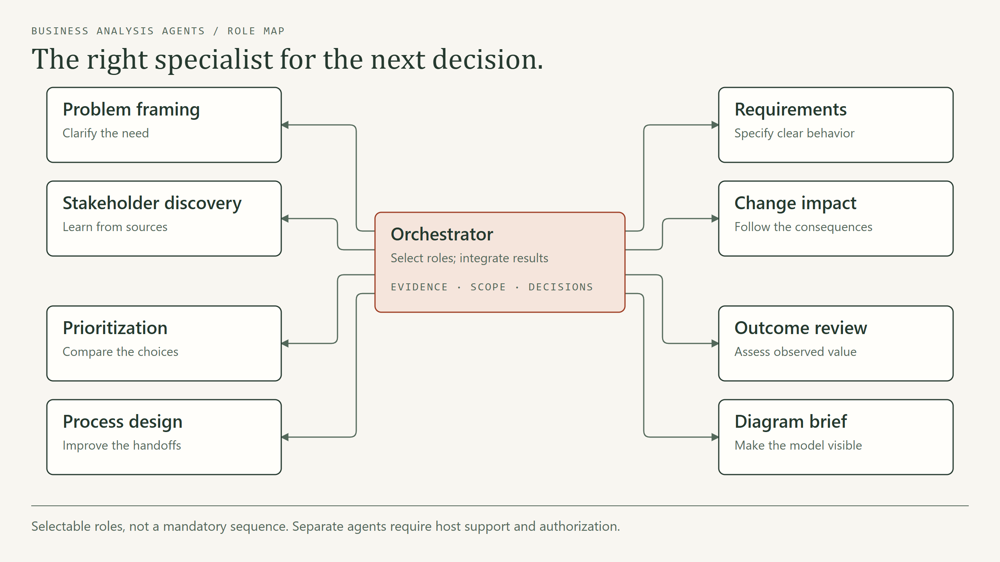
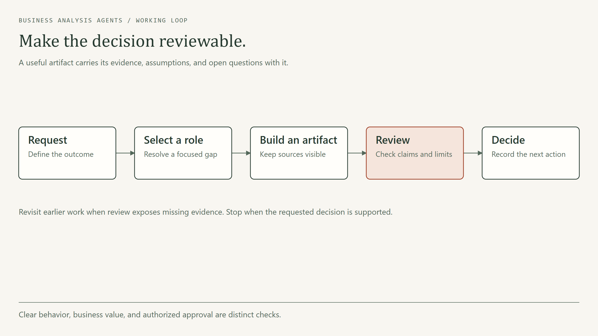

<div align="center">

# Business Analysis Agents

### From a vague request to a decision people can act on.

Reusable AI skills for discovery, requirements, prioritization, process improvement, and outcome review.

[](docs/validation.md)
[](LICENSE)
[](skills)
[](https://github.com/Guilsc/business-analysis-agents/stargazers)

[Quick start](#quick-start) · [Meet the agents](#meet-the-agents) · [See an example](examples/support-routing/README.md) · [Compatibility](docs/compatibility.md) · [Contribute](CONTRIBUTING.md)

</div>



## Start with the work in front of you

| Your situation | Start here | What you get |
|---|---|---|
| “We need a dashboard.” But why? | Problem framing | A focused problem brief and next investigation |
| People describe the same workflow differently | Stakeholder discovery | Source-linked findings and unresolved differences |
| A feature sounds clear until implementation starts | Requirements | Behavior, exceptions, and observable acceptance criteria |
| Everything is a priority | Prioritization | Explicit trade-offs, dependencies, and a decision record |
| Work gets stuck between teams | Process design | Current/proposed flow and improvement options |
| One change affects several systems | Change impact | Affected artifacts, risks, and transition needs |
| The pilot shipped, but did it help? | Outcome review | Evidence-based assessment and next action |

## Quick start

Clone the repository:

```bash
git clone https://github.com/Guilsc/business-analysis-agents.git
cd business-analysis-agents
```

Tell your assistant:

```text
Read skills/ba-orchestrator/SKILL.md and help me with this goal:
[describe the outcome, context, and evidence you have].
Select the smallest useful set of roles. Keep facts, assumptions, and
pending decisions separate. Return the artifact and the next action.
```

For automatic discovery in a compatible host, install the skill folders:

```bash
# Preview first. Use the root supported by your assistant.
python scripts/install.py --root /path/to/project/.agents/skills --dry-run
python scripts/install.py --root /path/to/project/.agents/skills
```

The installer copies all nine skills and refuses to overwrite an existing skill. Python 3.10+ is needed only for the installer and validator. Reading the skills requires no Python, API key, or package installation.

**ChatGPT or Rovo without local folder access?** Start with [the portable guide](portable/START-HERE.md), supply the relevant [role document](portable/roles), and use your workspace's supported instructions/knowledge interface. See [host setup](docs/compatibility.md).

## Meet the agents

| Skill | Responsibility | Typical artifact |
|---|---|---|
| [ba-orchestrator](skills/ba-orchestrator/SKILL.md) | Select roles and integrate decisions | Decision package and next action |
| [ba-problem-framing](skills/ba-problem-framing/SKILL.md) | Establish the need and scope | Problem brief |
| [ba-stakeholder-discovery](skills/ba-stakeholder-discovery/SKILL.md) | Gather and reconcile evidence | Research plan and evidence register |
| [ba-requirements](skills/ba-requirements/SKILL.md) | Specify behavior and review acceptance | Requirement cards |
| [ba-prioritization](skills/ba-prioritization/SKILL.md) | Compare choices and sequence work | Decision record |
| [ba-process-design](skills/ba-process-design/SKILL.md) | Improve operational flow | Current/proposed workflow |
| [ba-change-impact](skills/ba-change-impact/SKILL.md) | Follow a change through dependencies | Change note |
| [ba-outcome-review](skills/ba-outcome-review/SKILL.md) | Evaluate observed value | Outcome review |
| [ba-diagram-brief](skills/ba-diagram-brief/SKILL.md) | Make models understandable | Diagram source and viewable artifact |

These are reusable roles. Your host can apply them in one conversation or delegate to separate agents when it supports that capability and you authorize it. Installing a skill does not create a running agent.

## How orchestration works

1. **Frame the decision.** Establish the outcome, evidence, constraints, and definition of done.
2. **Choose the next useful role.** Route by missing work, rather than running every specialist.
3. **Produce and review an artifact.** Preserve evidence and unresolved questions through handoffs.
4. **Integrate the recommendation.** Explain the choice, trade-offs, and next action.

For example, “improve support routing” may need discovery before process design. If the routing pilot already exists and has measured results, start with outcome review. A request for a diagram can go directly to the diagram role when the underlying model is already known.

Read the [handoff contract](skills/ba-orchestrator/references/handoff.md), [routing scenarios](evals/routing.json), and [three reusable workflows](docs/workflows.md).

## A complete fictional example

**Northstar Support** wants automatic ticket assignment. The example follows an initial request through a problem brief, evidence, requirements, a decision, a change note, and a pilot review.

The evidence is deliberately limited. The recommendation stays proportional to it, and the pilot review does not invent a successful outcome.

**[Open the example →](examples/support-routing/README.md)**

## Templates you can use today

| Template | Purpose |
|---|---|
| [Problem brief](skills/ba-problem-framing/templates/problem-brief.md) | Establish the problem, evidence, scope, and next step |
| [Evidence register](skills/ba-stakeholder-discovery/templates/evidence-register.md) | Keep sources, interpretations, and confirmation states visible |
| [Requirement card](skills/ba-requirements/templates/requirement-card.md) | Connect behavior, conditions, exceptions, and acceptance |
| [Decision record](skills/ba-prioritization/templates/decision-record.md) | Explain a choice and what would reopen it |
| [Change note](skills/ba-change-impact/templates/change-note.md) | Assess consequences and preserve decision history |
| [Outcome review](skills/ba-outcome-review/templates/outcome-review.md) | Separate intended, observed, and still-unknown results |

## Diagrams with an editorial finish

The diagram role integrates with [Cathryn Lavery's diagram-design](https://github.com/cathrynlavery/diagram-design): clear HTML/SVG visuals for workflows, states, data, ownership, and dependencies.

Install that optional skill using its [upstream instructions](https://github.com/cathrynlavery/diagram-design#install). It is maintained separately and is not bundled here. The repository's overview diagram includes editable HTML source and an exported PNG.



## Works across assistants

The instructions do not specify a model provider. Folder-based Agent Skills hosts can discover `SKILL.md`; other interfaces can use the portable role guides as instructions and reference material.

| Environment | Route |
|---|---|
| Claude Code, Codex, Cursor, GitHub Copilot, OpenCode | Native skill folders; use the host's supported root |
| Visual Studio Code | Use the active AI extension/harness's skill support |
| Hermes | Install together under the active profile's skill category |
| ChatGPT, Rovo, other text-capable assistants | Native import if available, otherwise portable instructions/knowledge |

Tool access, rendering, context limits, and agent delegation vary. See [compatibility and verification](docs/compatibility.md); packaging checks are not a claim of live testing on every platform.

## Quality and trust

- Evidence, assumptions, recommendations, and authorized decisions stay distinguishable.
- Examples are fictional and labelled. No invented interviews or measured results.
- Roles are focused, with explicit deliverables and review questions.
- The validator checks skill metadata, references, registry targets, portable copies, and repository hygiene. An [opt-in CI template](docs/ci/README.md) runs these checks on Windows and Linux.
- [Behavioral evaluation cases](evals/README.md) describe expected observable behavior. They are prompts for testing a runtime, not fabricated benchmark scores.

See the [release validation record](docs/validation.md) for checks actually performed and their limits.

Run local checks with:

```bash
python scripts/validate.py
python -m unittest discover -s tests -v
```

## Contribute

Useful contributions include tested examples, clearer acceptance criteria, better routing cases, and verified host instructions. Start with [CONTRIBUTING.md](CONTRIBUTING.md) and the [roadmap](docs/roadmap.md). Please use synthetic or redistributable material.

If this helps your work, consider starring the repository or sharing a concrete example of how you used it.

## License and acknowledgments

Original repository content is [MIT licensed](LICENSE). This task-oriented toolkit includes no member-book PDF, raw book extraction, or chapter-summary pack. It is not an official publication or certification product of a professional standards body.

Visual design follows the separately maintained [diagram-design](https://github.com/cathrynlavery/diagram-design) project. See [NOTICE.md](NOTICE.md) for attribution and [provenance](docs/provenance.md) for content boundaries.
