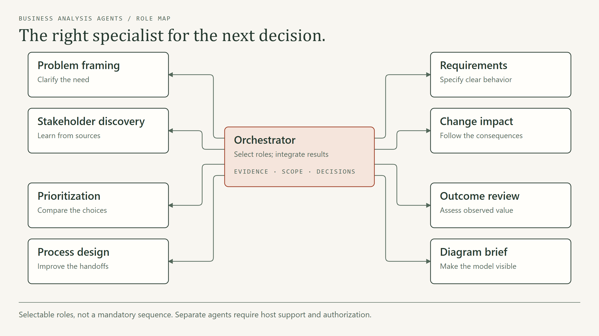
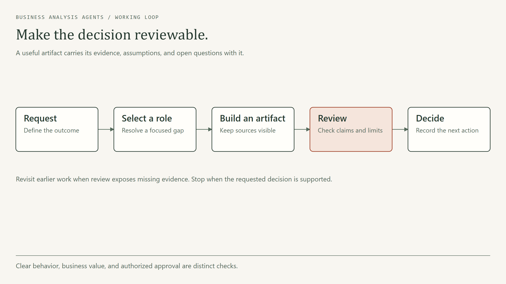

# Architecture and execution boundaries

## Components

| Component | Responsibility | Boundary |
|---|---|---|
| `skills/ba-orchestrator/` | Select the next useful role using the role registry and handoff contract | Instructions interpreted by the host, not a scheduler |
| Other `skills/ba-*/` folders | Produce and review focused analysis artifacts | Tools and delegation depend on host capabilities and user authorization |
| `portable/roles/` | Text-only copies for hosts without native skill discovery | Generated by `scripts/build_portable.py`; edit native sources first |
| `scripts/install.py` | Copy all nine skill folders to an explicit host root | Refuses existing destination skills; does not start agents or install optional tools |
| `scripts/validate.py`, `tests/` | Check packaging, links, registry, portable sync, and installer behavior | Not evidence of model accuracy or live host compatibility |
| `evals/` | Describe routing and behavior scenarios | Requires a separately selected runtime and human review |

## Data and authority

The user supplies the goal and evidence to the assistant host. The orchestrator routes missing work to a focused role, then integrates the returned artifact, assumptions, unresolved decisions, and next action. A role handoff is governed by the [handoff contract](../skills/ba-orchestrator/references/handoff.md), not by an undocumented API.

The repository has no server, database, credentials, telemetry, or bundled model. The assistant host controls file access, tools, context, and model calls. Keep operational evidence in an authorized workspace; use the repository's fictional examples for demonstrations. A recommendation is not authorization to change a system or approve a business decision.

## Maintainer path

1. Edit native skill instructions, references, or templates.
2. Run `python scripts/build_portable.py` when native content changes.
3. Run `python scripts/validate.py` and `python -m unittest discover -s tests -v`.
4. Review runtime behavior separately using [evaluation scenarios](../evals/README.md).

The diagrams above are existing editable HTML/PNG artifacts under `docs/assets/`; they describe analysis flow, not deployed infrastructure.
